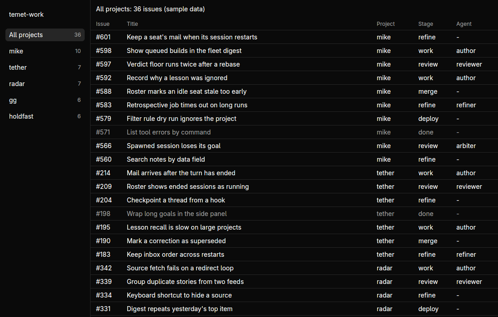

---
session_id:
  - f7d71e90-1e85-48b8-98e1-c72951b77c6d
---

# GPUI and gpui-component on omit

What happened when `spikes/gpui-shell` was built and run on 26 November 2026: one window with a
projects sidebar and a virtual list of issue rows. The issues are made-up sample data in
`src/main.rs`.



The machine has 16 cores and an NVIDIA GPU (driver 615.78.08) and runs Hyprland 0.56.2 on Wayland, and the
toolchain was Rust 1.98.1.

## Versions

| Dependency name | crates.io package | Version |
|---|---|---|
| `gpui` | `gpui-pre` | `=0.3.14` |
| `gpui_platform` (feature `wayland`) | `gpui-pre-platform` | `=0.3.14` |
| `gpui-component` | `gpui-component` | `0.11.0` |
| `gpui-kit-assets` | `gpui-kit-assets` | `0.11.0` |

- `gpui-component` 0.11.0 requires `gpui-pre =0.3.14`, which its crates.io description calls a
  snapshot of Zed's source (`zed@f126950`). The `gpui` crate (0.2.2) is a different package. No git revision was
  needed.
- `gpui-pre` and `gpui-component` have one crates.io owner, `huacnlee` (Jason Lee). The `gpui`
  crate is owned by Zed's people and Zed's `crates-io` team.
- `gpui-pre` had a release every week or two from 0.3.0 (3 September) to 0.3.14 (23 November).
- `cargo tree -d --depth 0 | rg gpui` prints nothing, and `Cargo.lock` holds one `gpui-pre`.
- `Cargo.lock` holds 790 packages across all platforms. The `gpui*` crates compiled for Linux are
  Apache-2.0.
- No `gpui-component` feature is on, so no tree-sitter grammar is compiled.

## Build times

Every command ran in `spikes/gpui-shell/` with `CARGO_TARGET_DIR="$PWD/target"` and
`nice -n 10`. Crates were already downloaded (`cargo fetch` took 18 s). Other sessions were
working on the machine; the 1-minute load average was between 6.5 and 10.

| Build | Command | Wall time |
|---|---|---|
| Clean, debug | `cargo build -j 4` | 158 s |
| Clean, release | `cargo build -j 4 --release` | 324 s |
| One line changed in `src/main.rs`, debug | `cargo build -j 4` | 11.7 s, 8.9 s, 11.1 s |
| One line changed in `src/main.rs`, release | `cargo build -j 4 --release` | 3.7 s, 3.0 s |
| Nothing changed, debug | `cargo build -j 4` | 0.3 s |

The changed line was `const ROW_HEIGHT`. The debug rebuild was about three times as slow as the
release rebuild; why was not measured.

## Size and running cost

| | Debug | Release |
|---|---|---|
| Binary | 767 MB | 53 MB (39 MB after `strip`) |
| Window listed by `hyprctl` after launch | 1.03 s, 0.88 s | 0.65 s, 0.33 s |
| Resident memory | 226 MB, 227 MB | 211 MB, 178 MB |
| CPU while idle, over 10 s | 0.1%, 0.2% | 0.1%, 0.1% |
| GPU memory (`nvidia-smi`) | 50 MiB | 50 MiB |

`target/` was 4.4 GB after the clean debug build and 6.2 GB with the release build added.

`hyprctl clients -j` showed class `temet-work-gpui-shell`, `xwayland: false` and the requested
size of 1100x700 (floating).

## Problems

### The first build failed on the row function

The only compile errors. All dependencies compiled; the failure after 146 s was three of these,
in `src/main.rs` (line numbers as the file was then):

```text
error: lifetime may not live long enough
   --> src/main.rs:201:17
    |
195 |               |this, range, _, cx| {
    |                ----              - return type of closure `Vec<impl IntoElement>` contains a lifetime `'2`
    |                |
    |                has type `&'1 mut Shell`
```

In edition 2024 a returned `impl IntoElement` captures the lifetimes of the arguments, here
`&self` and `cx`. Fix: declare the row function as `-> impl IntoElement + use<>`.

### The list calls the row closure for one row to measure it

No error. A log line in the `v_virtual_list` closure alternated between these two:

```text
built rows 0..1 of 36
built rows 0..23 of 36
```

The one-row call is the measuring pass, and code that reacts to the visible range (loading
more rows, for example) has to ignore it. The spike logs only ranges longer than one row.

### The platform crate has no window backend unless a feature asks for one

Read in `Cargo.toml`, not run. The application is created by `gpui_platform::application()`.
`gpui-pre-platform` depends on `gpui-pre-linux` with `default-features = false`, and its own
default feature is only `multithreaded`. The spike turns on `wayland`. `x11` is off, and a build
for an X11 session was not tried.

### A second `gpui` if the versions are mixed

Read from the dependency lists, not run. `gpui = "0.2.2"` beside `gpui-component` 0.11.0 would put
two `gpui` packages in the build with incompatible types, so the spike depends on `gpui-pre` under
the name `gpui`.

No build script failed and the final build printed no warning.

## What gpui-component gave and what the spike wrote

| From gpui-component 0.11.0 | Written in `src/main.rs` (265 lines) |
|---|---|
| `Sidebar`, `SidebarHeader`, `SidebarMenu`, `SidebarMenuItem` with active state and a suffix slot (used for the counts) | The filter that a sidebar click applies |
| `v_virtual_list`, `VirtualListScrollHandle`, `Scrollbar` | The row height list the virtual list takes, one size per row |
| The default dark theme (`Theme::change`) and its colour names | The columns, shared by the header line and the rows |
| `Root`, `h_flex`, `v_flex` | Opening the window, setting `app_id`, quitting when it closes |

The crate also has `table` (with a `DataTable`) and `dock` modules. Neither was tried; the rows
here are plain flex rows.

## Running it

```sh
cd spikes/gpui-shell
CARGO_TARGET_DIR="$PWD/target" nice -n 10 cargo build -j 4 --release
./target/release/gpui-shell
```

For the screenshot the app was started on an empty, visible workspace without taking focus:

```sh
hyprctl dispatch "hl.dsp.exec_cmd('$PWD/target/release/gpui-shell', { workspace = '2 silent', float = true, no_initial_focus = true })"
grim -g "3780,1774 1100x700" ../../docs/findings/gpui-shell.png
```

The geometry is the window's `at` and `size` from `hyprctl clients -j`. The focused window was the
same before and after each launch. The window was closed by ending its process.

## For temet-work

### The app

Build on:

- `gpui-component` 0.11.0 with `gpui-pre` pinned to the version it requires. The pair built and
  ran on Wayland with NVIDIA at the first launch (Versions, Size and running cost).
- `Sidebar` and `v_virtual_list` for the project list and long issue lists. The first frame built
  23 of 36 rows (Problems).
- The default dark theme as a starting point: the screenshot uses it unchanged.

Avoid:

- Depending on `gpui` 0.2.2 beside `gpui-component` (Problems).
- Upgrading `gpui-pre` on its own. `gpui-component` pins it with `=`, so the two move together
  (Versions).
- Turning on syntax highlighting features before a screen needs them (Versions).

Still unknown:

- Whether clicking a project filters the list in the running window. The code is there; no click
  was sent to the live desktop.
- Scrolling, keyboard focus and navigation, text input and IME, tiled resizing, scale other than 1,
  accessibility with a screen reader.
- `DataTable`, `dock`, and text-heavy views such as diffs.
- How an upgrade to newer `gpui-pre` and `gpui-component` releases goes; only one pair was
  built.
- What `gpui-pre` guarantees. It is published by the `gpui-component` owner, not by Zed (Versions).
- macOS, X11, and whether smaller debug info shortens the debug rebuild.

### The daemon

Build on:

- A daemon in its own crate with no GPUI dependency, so that building the daemon alone does not
  compile the app's dependencies, which took 158 s and 4.4 GB of disk in debug (Build times,
  Size and running cost). This is a recommendation; no daemon was built.
- A fixed target directory per checkout for app builds: with it a one-line change rebuilt in
  3 to 12 s (Build times).

Avoid:

- Clean builds of the app in per-item work folders. Each costs 158 s (debug) on four cores and
  4.4 GB of disk (Build times).

Still unknown:

- How the app receives daemon state: feeding a socket stream into GPUI's executor and redrawing
  was not tried, because the spike's data is a fixed table in `main.rs`.
- Whether a shared compiler cache shortens the clean build. None was set up for these builds.
